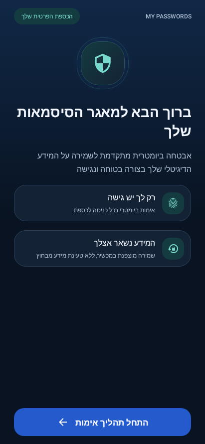
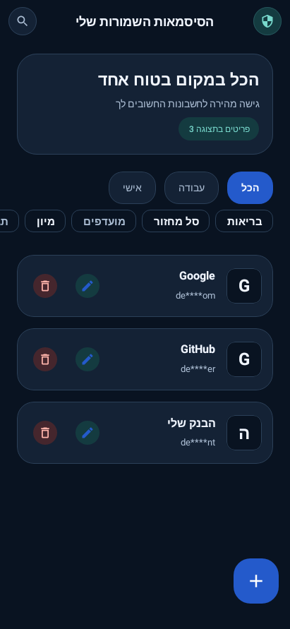
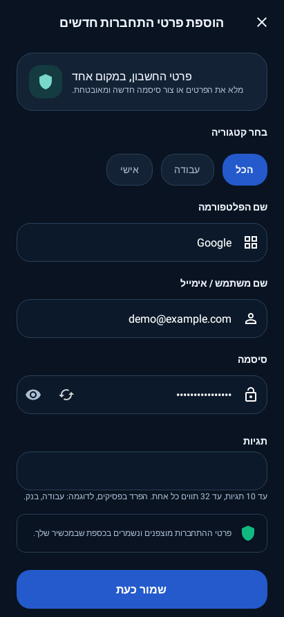
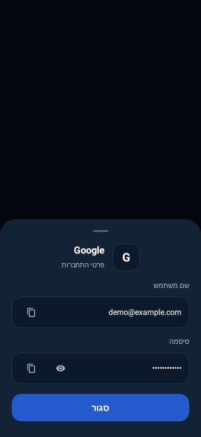
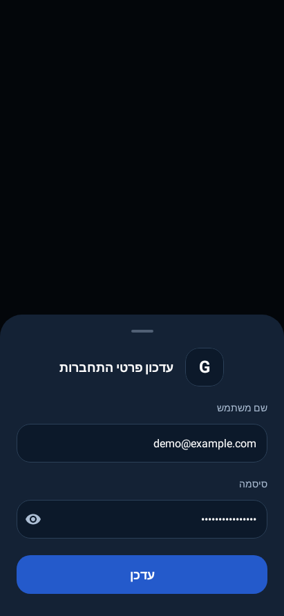

# MyPasswords

A local Android password vault built with Kotlin and Jetpack Compose. MyPasswords combines biometric access, encrypted storage, and tools for organizing and maintaining saved credentials in a dark blue and teal interface.

The app currently uses a Hebrew, right-to-left interface. This documentation is in English.

## Contents

- [Features](#features)
- [Screenshots](#screenshots)
- [Getting started](#getting-started)
- [Using the vault](#using-the-vault)
- [Security and recovery](#security-and-recovery)
- [Architecture](#architecture)
- [Tests and verification](#tests-and-verification)
- [Contributing](#contributing)
- [License](#license)

## Features

- **Biometric access:** unlock the vault through Android's strong biometric authentication and lock it when the app leaves the foreground.
- **Encrypted credentials:** store usernames and passwords using AES-GCM field encryption inside a SQLCipher-encrypted Room database.
- **Credential management:** add, view, edit, copy, and delete saved login details; generate passwords using a cryptographically secure random source.
- **Organization:** categories, favorites, and custom tags, with sorting by name or creation date.
- **Expanded search:** match multiple words across platform names, usernames, websites, and tags. Search terms are combined with AND and matched without case sensitivity.
- **Password health:** identify reused passwords, common or repetitive patterns, short passwords, and older passwords with known change dates. Analysis runs locally on active entries.
- **Password history:** retain encrypted snapshots when a password changes and restore a previous version after confirmation.
- **Recycle bin:** restore deleted entries or delete them permanently, with a 30-day retention period.
- **Recovery code:** configure a recovery code while the vault is accessible, allowing recovery after biometric key invalidation on the same installation.
- **Clear interface states:** separate loading, empty, no-results, and error states, including retry actions.

The application does not request Internet access. It currently has no cloud synchronization, portable vault export, Android Autofill integration, or passkey management.

## Screenshots

These images are rendered from the application's Compose screens by local Robolectric tests using synthetic accounts. They show the app UI, not a real vault or the Android system biometric prompt. The production app protects its window with `FLAG_SECURE`; screenshot protection remains enabled.

| Welcome | Authentication | Saved passwords |
| --- | --- | --- |
|  |  |  |

| Add credentials | Credential details | Edit credentials |
| --- | --- | --- |
|  |  |  |

## Getting started

### Requirements

| Requirement | Project configuration |
| --- | --- |
| Android Studio | A version compatible with Android Gradle Plugin 9.4.1 |
| Gradle runtime | JDK 21; daemon criteria are provided in `gradle/gradle-daemon-jvm.properties` |
| Android SDK | Compile SDK 37; target SDK 36 |
| Minimum Android version | Android 7.0 / API 24 |
| Gradle | 9.8.1, through the included wrapper |
| Java source and target compatibility | Java 11 |
| App package | `com.example.mypasswords` |

Running the app requires a supported strong biometric enrolled on the device and an enabled screen lock. Building and running the local test suite do not require a device or emulator.

### Open and build

1. Open the repository root in Android Studio.
2. Install Android SDK platform 37 through SDK Manager.
3. Use JDK 21 for Gradle and allow the project to sync. The configured toolchain resolver can provision the requested Gradle JVM when necessary.
4. Build the debug application with the project's Gradle Wrapper:

```sh
./gradlew :app:assembleDebug
```

The debug APK is written to:

```text
app/build/outputs/apk/debug/app-debug.apk
```

Select a compatible Android device and run the `app` configuration in Android Studio to launch it. No server, API token, or cloud account configuration is needed. The first build needs network access to resolve Gradle, dependencies, and any missing toolchain components; the app itself operates locally.

On Windows, use `gradlew.bat` in place of `./gradlew`.

## Using the vault

1. Start from the welcome screen and authenticate with an enrolled strong biometric.
2. Use the **+** button to save an account. Choose a category, enter a platform name and login details, and optionally add tags.
3. Open a saved entry to view or copy its details and manage its favorites, tags, or password history. Use the edit action to update its credentials.
4. Use search, category filters, favorites, and sorting to find entries. Tags accept comma, semicolon, or newline separators, with up to 10 tags of 32 Unicode code points each.
5. Open the health report to review active credentials. Its checks are local heuristics, not a breach lookup or a guarantee of password strength. Older-password notices are advisory and do not force rotation.
6. Deleted entries move to the recycle bin. Restoring an entry preserves its tags, favorite status, and password history.
7. Configure a recovery code through the security action while the vault is unlocked. Keep the displayed code somewhere safe outside the vault; it is shown once.

### History and retention behavior

- History begins when a stored password is changed. Earlier versions cannot be reconstructed retroactively.
- Changing only a username does not create a password-history entry.
- Restoring an older password archives the current one first. It updates the saved vault entry; it does not change the password on the corresponding website or service.
- Entries in the recycle bin expire after **30 days**. Expired entries are purged at the next successful vault opening or when the recycle bin is opened. Cleanup cannot run while the encrypted vault is locked, so deletion is not scheduled for an exact background time.
- Permanent deletion requires confirmation and removes the entry's associated history.

## Security and recovery

### Storage and session protection

| Layer | Implementation |
| --- | --- |
| Vault database | Room backed by SQLCipher |
| Sensitive credential fields | AES-GCM with fresh initialization vectors |
| Database passphrase | Wrapped using a biometric-authenticated Android Keystore key; the wrapped value is persisted in encrypted preferences |
| Biometric policy | Strong biometric authentication with authentication required for key use |
| Session lifecycle | A central `VaultSession` owns access state and in-memory key material; locking revokes access and clears owned mutable buffers and cached usernames |
| Screen capture | `FLAG_SECURE` on the main app window |
| Clipboard | Password copies are marked sensitive and scheduled for cleanup after 60 seconds, with lifecycle-based cleanup retries |
| Backup | Android cloud backup is disabled; backup rules also exclude vault data from cloud backup and device transfer |

Hardware protection of Keystore keys depends on the device. Clipboard cleanup is best effort because Android can restrict background clipboard access or stop the app process. Mutable secret buffers are cleared where owned by the app; managed-runtime strings and provider-internal copies cannot be comprehensively erased.

### Recovery boundaries

Biometric enrollment changes can invalidate the key used to unlock the vault. A previously configured recovery code can unwrap the existing vault key, after which a new biometric authentication binds access to a replacement key.

Recovery must be configured **before** access is lost. It cannot retroactively recover an already invalidated key when no recovery code was configured. The recovery code is not a portable backup and does not provide recovery after uninstalling the app, clearing its data, or losing the device.

Password-health analysis does not persist decrypted passwords or reuse fingerprints. Reuse detection operates on temporary in-memory fingerprints. The checks do not query external breach services.

## Architecture

The project uses ViewModels, repositories, Kotlin coroutines, `StateFlow`, and Hilt dependency injection. Compose screens collect state with lifecycle awareness, while persistence and session management live in the core module.

| Module | Responsibility |
| --- | --- |
| [`app`](app) | Application entry point, navigation, screens, ViewModels, theme, and localized UI errors |
| [`core`](core) | Authentication, vault session, cryptography, database and repositories, domain models, validation, search, health analysis, and retention rules |
| [`compose-ui`](compose-ui) | Shared form fields, buttons, category components, credential sheets, and sensitive clipboard handling |

```text
MyPasswords/
├── app/src/main/              # App, navigation, screens, and theme
├── app/src/test/              # ViewModel and local Compose UI tests
├── core/src/main/             # Domain logic, authentication, crypto, and data
├── core/src/test/             # Logic, persistence, and security-boundary tests
├── compose-ui/src/main/       # Reusable Compose components
├── compose-ui/src/test/       # Component and clipboard tests
├── docs/screenshots/          # Synthetic app UI images used in this README
├── gradle/libs.versions.toml  # Shared dependency versions
└── build.gradle.kts           # Root build and unified local test task
```

Room schema version 2 includes a non-destructive migration from version 1 for organization metadata, recycle-bin timestamps, and encrypted password history. Password updates and history archiving are transactional.

## Tests and verification

All automated tests run locally with JUnit, MockK, Robolectric, coroutine test utilities, and Compose UI testing. No test APK installation, physical device, or emulator is required.

### Run the complete suite

```sh
./gradlew runAllTests
```

This runs the debug unit tests in all three modules and forces test execution while retaining compilation caches. Gradle's **actionable tasks** count refers to build tasks, not the number of test cases.


## Contributing

Follow the project's development instructions and existing module boundaries. Keep shared validation and vault rules in `core`, reusable UI in `compose-ui`, and screen orchestration in `app`. Add regression tests for behavior changes and run the relevant local tests, lint, and debug build before requesting review.

Do not add real credentials or personal vault data to source files, fixtures, logs, or screenshots.

## License

This repository currently does not include a `LICENSE` file.
